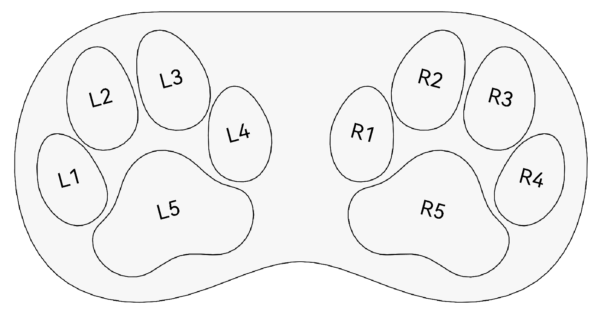

# About

PogPaws is a 10 button keyboard in the shape of pawpads. It connects to a PC through a micro USB cable. The buttons can be configured to any key combo you so desire. It is based on a raspberry pi pico.

I made this as a personal project some 4 years ago ( --.-- ) and I'm finally getting around to posting it on the internet. I've made a few of these and given them as trophies at gaming tournaments. If you won a PogPaws, congrats! If you'd like to see any additional features, requests and PRs are welcome.

# Configuration

To enter "Configuration Mode", simply plug in PogPaws while pressing any button. Check your File Explorer to view the PogPaws as a mounted drive. Inside the folder, there will be a file named ```config.json```. This is the file you edit with your desired keyboard inputs. Inputs can be values such as:

```
A
B
C
ONE
TWO
THREE
DELETE
DOWN_ARROW
SHIFT
```

The keys are US Keyboard layout, so if you want and exclamation mark (!), use
```
SHIFT,ONE
```

[Here is a comprehensive list of valid keycodes](https://docs.circuitpython.org/projects/hid/en/latest/api.html#adafruit_hid.keycode.Keycode).


>[!NOTE]
>JSON files are picky! If you mis-format the JSON, PogPaws may silently fail (it doesn't send any keystrokes and there's no LED or notification saying it is broken). Make sure every line follows the pattern of the original ```config.json```

## Keyboard layout

There are 10 keys, 5 on the left pawpad, 5 on the right. They are numbered on each paw left to right, with the big pawpad being last. 



# Installation

You will need to download three things: This code, Circuit Python, and the keyboard library.

### Download Circuit Python

Download [CircuitPython](https://circuitpython.org/board/raspberry_pi_pico/). I'm currently publishing this example with version 10.3.2 for the Raspberry Pi Pico.

#### Install Circuit Python

Hold the BOOTSEL button while plugging in PogPaws. The BOOTSEL button is the button on the back. A file explorer should pop up. Copy the downloaded .UF2 file to the drive. The board should reboot after it receives the file.

### Download this Repository

Towards the upper right of [this page](https://github.com/BasedOtt/PogPaws), there's a colorful "Code" button. Choose "Download ZIP". Or you can [click here](https://github.com/BasedOtt/PogPaws/archive/refs/heads/main.zip). Unzip the contents.

### Keyboard Library

Download [the library bundle](https://circuitpython.org/libraries). Make sure it matches the version of the .UF2 file! (10.x in this example)

Unzip the file. Go inside and find the folder named "adafruit_hid". Copy it and paste it into the folder of this repository's code.

## Install PogPaws Code

Copy all these files into the PogPaws drive.

boot.py
code.py
config.json
pinout.py
adafruit_hid folder

Unplug, replug, and PogPaws should now be working!